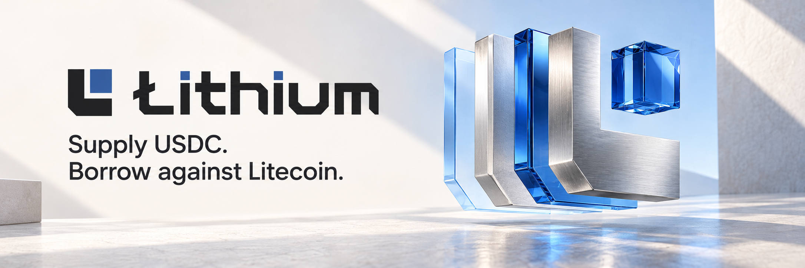

  

# Lithium

Lithium is a non-custodial lending protocol for supplying USDC and borrowing
against native Litecoin collateral on LitVM.

  <a href="https://www.lithiumlend.com/app">Application</a> ·
  <a href="https://www.lithiumlend.com/docs">Documentation</a> ·
  <a href="https://www.lithiumlend.com/app/faucet">Faucet</a> ·
  <a href="https://github.com/orgs/Lithium-Lend/discussions">Discussions</a> ·
  <a href="https://x.com/lithiumlend">X</a> ·
  <a href="https://discord.gg/kfYspqQXhe">Discord</a>

## Protocol

| Component | Description |
| --- | --- |
| Lending market | Supply USDC and borrow USDC against native zkLTC collateral |
| Contracts | Open-source lending contracts, deployment records, and verification inputs |
| Interface | Wallet-native market, faucet, account history, and protocol documentation |
| Community | Public proposals, questions, integration help, and ecosystem updates |

## LiteForge

| Resource | Value |
| --- | --- |
| Network | LitVM LiteForge |
| Chain ID | `4441` |
| Native asset | `zkLTC` |
| Explorer | [LiteForge Explorer](https://liteforge.explorer.caldera.xyz) |

## Repositories

- [`contracts`](https://github.com/Lithium-Lend/contracts): protocol contracts,
  tests, deployment records, and source verification
- [`community`](https://github.com/Lithium-Lend/community): organization
  discussions and community resources

